# Designvoorstel — ResoFly Stroom — 2026-10-30

## De vraag

> Ik wil dat je helemaal los gaat en een mindblowing nieuw design voor me ontwerpt voor deze app.
> De app dient maximaal modern te zijn, intuïtief en een wauwfactor creëren bij mensen zonder de
> essentie van de app te verliezen.

Dit is het voorstel. Het bestaat uit een werkend prototype in een voorstelpagina, beelden en de bron.
De invoering staat onderaan, met de vijf keuzes. Die zijn gemaakt: Stroom staat in de app, achter
*Probeer Stroom* (zie `CHANGELOG_STROOM_2026-10-30.md`).

## Bekijken

| wat | waar |
|---|---|
| Voorstelpagina met het werkende prototype: zeven schermen, het eiland, de stroom, beslissen, plannen, betalen, inloggen, drie telefoons, het systeem en de invoering | `docs/design-voorstel-stroom/index.html` (dubbelklikken), of online: https://claude.ai/artifact/WJieZCTqA4iCzNpCBeRb1i (privé; deel het via het Share-menu) |
| Beelden van de schermen in Nacht en Dag | `docs/design-voorstel-stroom/beelden/` |
| De bron, met één tokenbron voor alle kleuren | `docs/design-voorstel-stroom/bron/` (`node docs/design-voorstel-stroom/bron/build.mjs`) |

Het prototype speelt op dezelfde dag en met dezelfde gegevens als het Zenit-voorstel: Studio Lopik op
donderdag 22 oktober 2026 om 09:41, uit de testomgeving (`tests/mobile/mock/seed.mjs`). Zo leg je de
twee naast elkaar.

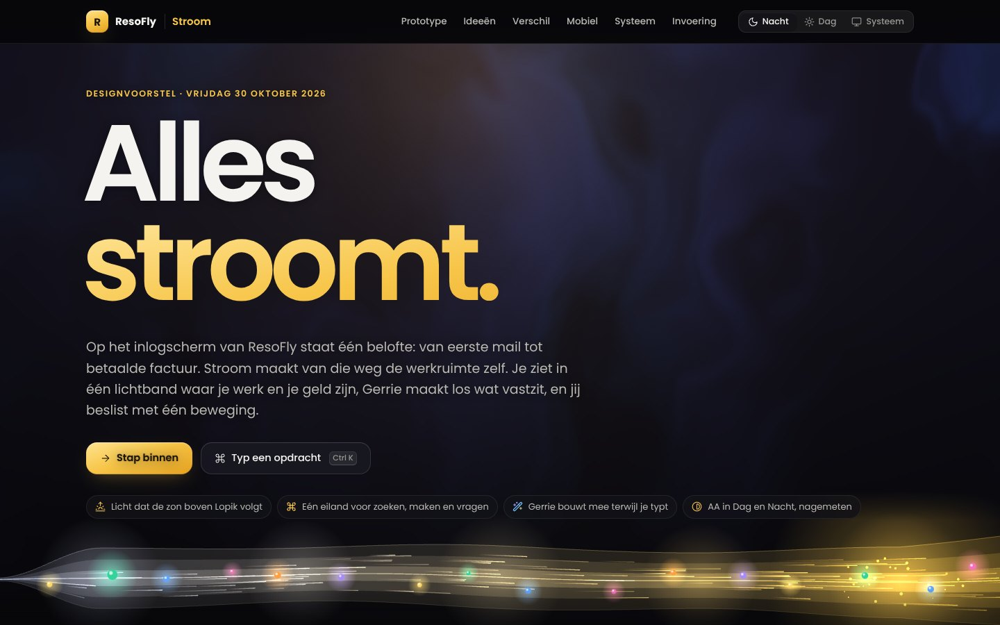

## Het idee

Op het inlogscherm van ResoFly staat één belofte: *van eerste mail tot betaalde factuur*. **Stroom**
maakt van die weg de werkruimte zelf. Alles wat je in ResoFly doet, brengt iets een halte verder:
een gesprek wordt een offerte, een offerte wordt werk, werk wordt een factuur, een factuur wordt geld.
Stroom laat die beweging zien, Gerrie houdt haar op gang, en de werkruimte zelf doet een stap opzij.

Het merk verandert niet: het R-merkteken, grafiet en zongoud, het poollicht van Gerrie en Poppins
blijven precies zoals ze zijn. Ook de zeven modules van Zenit (Vandaag, Gerrie, Agenda, Werk, Geld,
Berichten, Inzicht) en de rechten per module blijven. Wat verandert, is hoe je werkt, en het
materiaal: glas op een levend lichtveld.

## Zes ideeën

1. **De stroom.** Je bedrijf als één lichtband in vijf haltes: Gesprek, Offerte, Werk, Factuur,
   Betaald. De breedte is het bedrag (in oktober € 4.452,80 · € 3.327,50 · € 4.840 · € 3.690,50 ·
   € 6.292), het licht gaat van koel maanlicht naar zongoud, en wat binnen is, ligt als een poel van
   goud aan het eind. Elk ding dat onderweg is, is een kraal in de kleur van de klant. Een **knoop**
   gloeit waar iets vastzit: oranje voor offerte 2026-020 (9 dagen bij Van Dijk), rood voor factuur
   2026-040 (10 dagen te laat bij Bloem). Heeft Gerrie iets klaar, dan staat zijn orbje ernaast; een
   klik opent het voorstel. Dezelfde vijf haltes staan als **stroomlijn** bij elke klant.
2. **Het eiland.** Eén vlak bovenin voor zoeken, springen, maken en Gerrie iets vragen (<kbd>⌘K</kbd>
   of <kbd>/</kbd>). Het draagt ook wat nú loopt: de timer van je focusblok, Gerrie die iets
   uitzoekt, en de tien seconden waarin je een mail terughaalt. Het vervangt het zoekveld, de knop
   Nieuw, de zwevende Gerrie-knop, de meldingen en de urentimer. Verlaat je Vandaag, dan krimpt de
   Nu-kaart tot de timer in het eiland.
3. **Gerrie bouwt mee.** Typ *factuur bloem content oktober 650* en het eiland ontleedt het (Factuur ·
   Restaurant Bloem · Content oktober · € 650,00 excl.), terwijl ernaast de factuur zich vult tot
   2026-043 met € 136,50 btw en € 786,50 totaal. Enter zet hem als concept klaar en hij vliegt naar
   Geld; er wordt niets verstuurd. Hetzelfde werkt voor *offerte*, *taak*, *afspraak* (met een
   botsing-check op je dag) en *uren*. Een vraag krijgt het antwoord in het eiland zelf, met knoppen
   voor de volgende stap.
4. **Beslissen in één beweging.** Wat Gerrie en de agents klaarzetten, ligt als een stapel op Vandaag
   en in de beslismodus. Akkoord, later of niet meer: met een klik, met <kbd>A</kbd>, <kbd>L</kbd>,
   <kbd>N</kbd>, of door te vegen (ook met de muis). Een mail gaat pas na tien seconden de deur uit;
   het eiland telt af met *Ongedaan maken*. De knoop in de stroom gaat zichtbaar los
   (*1 opgevolgd*). Betaalt Karim, dan reist de kraal naar Betaald, telt het bedrag op en haalt Gerrie
   de herinnering die niet meer nodig is zelf van je stapel.
5. **Licht dat leeft.** De grond onder het glas is een WebGL-lichtveld: de zon staat waar hij boven
   Lopik staat (om 09:41 laag links, warm), het poollicht van Gerrie komt van rechts, elke klant
   kleurt het veld een beetje (Bloem oranje, Van Dijk blauw), en een betaling of een akkoord geeft een
   rimpel van goud vanuit het merkteken. Dag en Nacht zijn hetzelfde veld in een ander licht; de
   pagina wisselt met een cirkel van licht vanuit waar je klikte.
6. **Alles beweegt mee.** Niets springt. Een scherm komt binnen met een View Transition, een factuur
   groeit uit zijn regel tot papier, het eiland verandert van vorm met een echte veer (`linear()`),
   en *Plan met Gerrie* laat de taken naar hun plek in je week zweven (twee op vrijdag, de derde naar
   maandag omdat hij deze week niet meer past). Met *minder beweging* werkt alles net zo, zonder te
   zweven.

| Nacht | Dag |
|---|---|
| 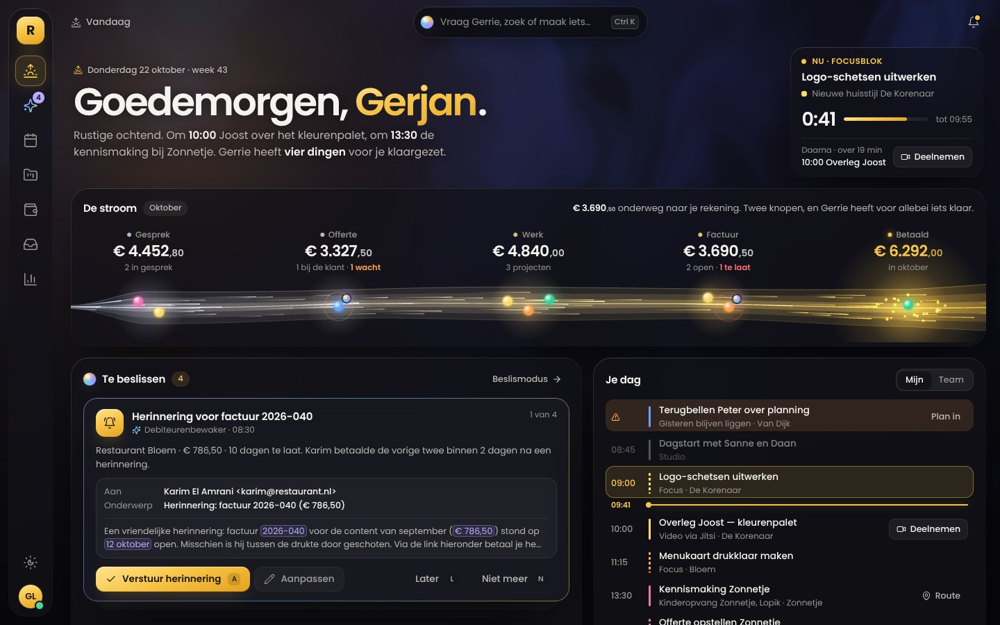 | 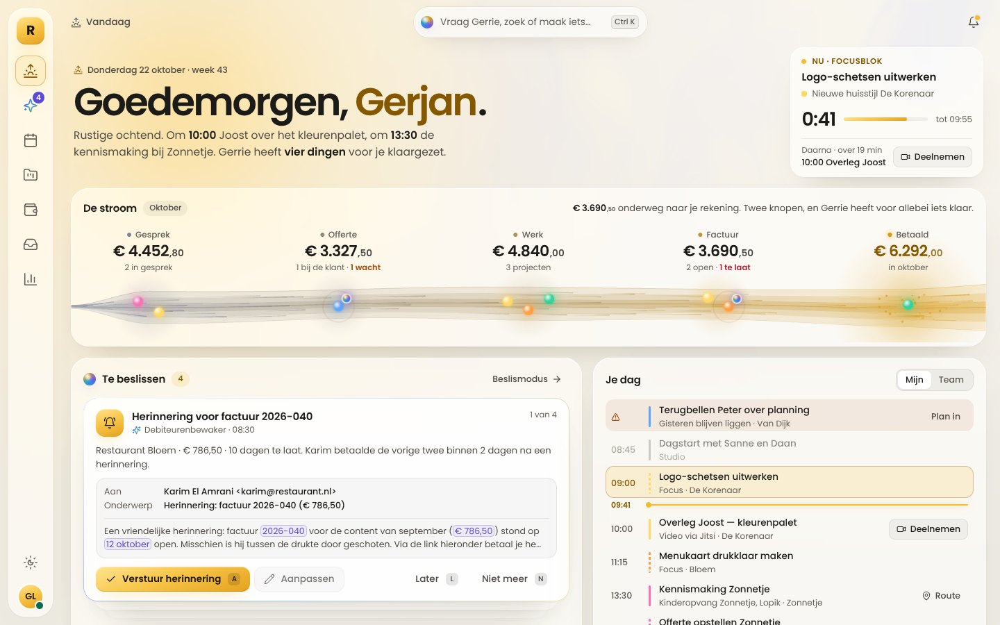 |
| 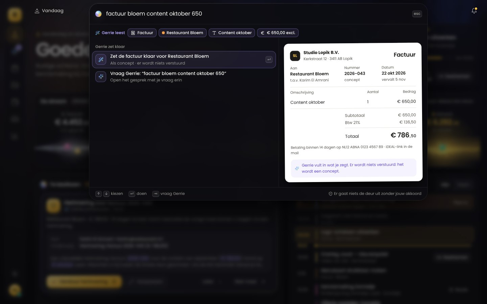 | 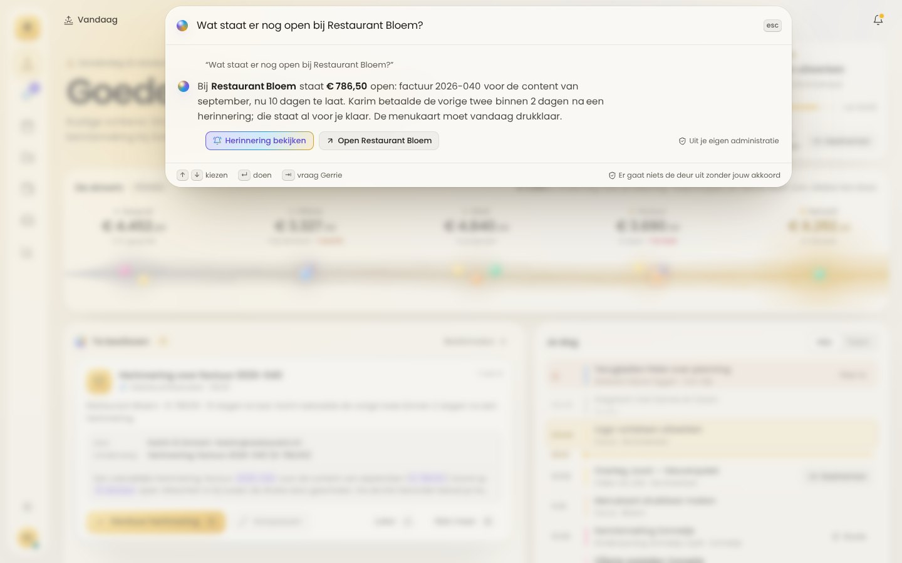 |
| 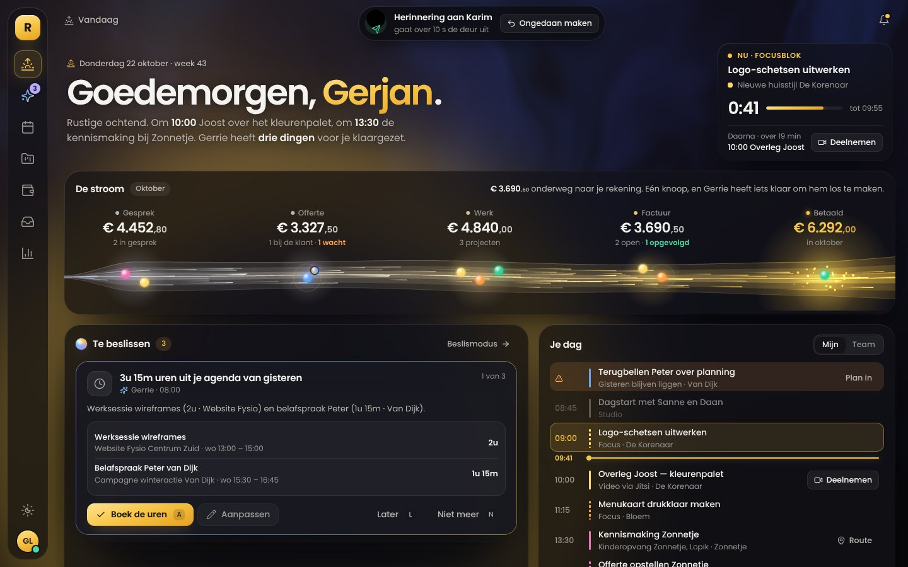 | 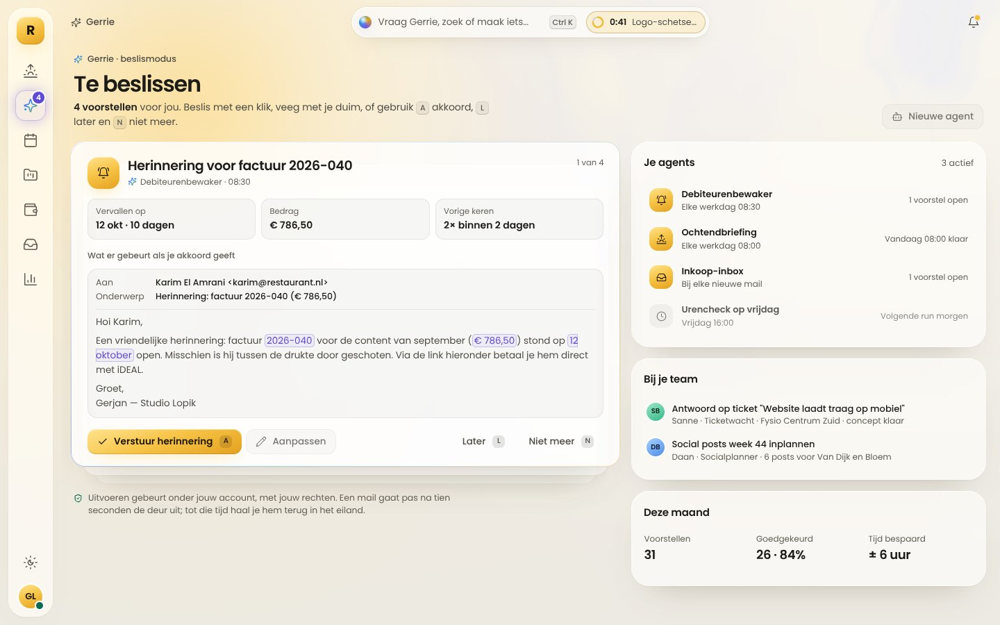 |
| 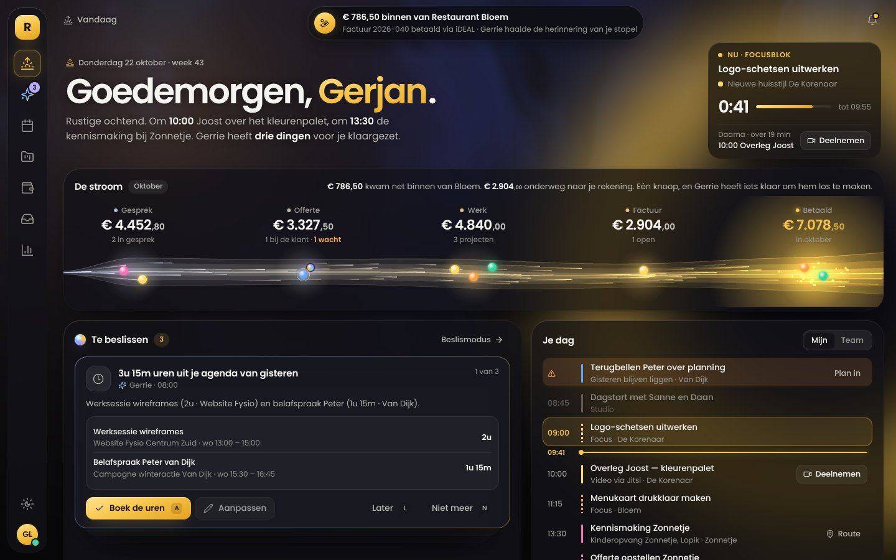 | 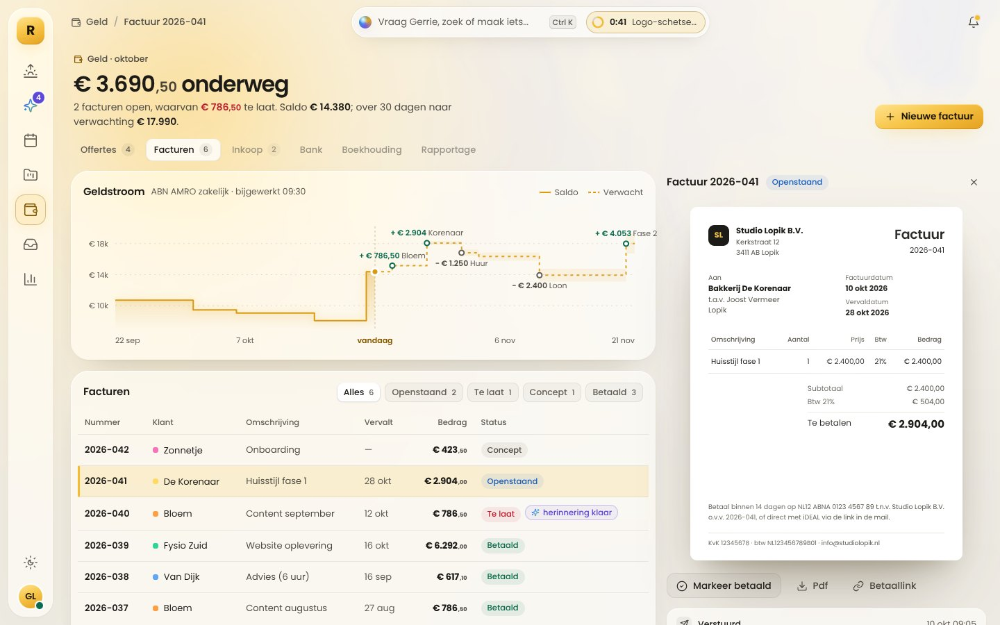 |
| 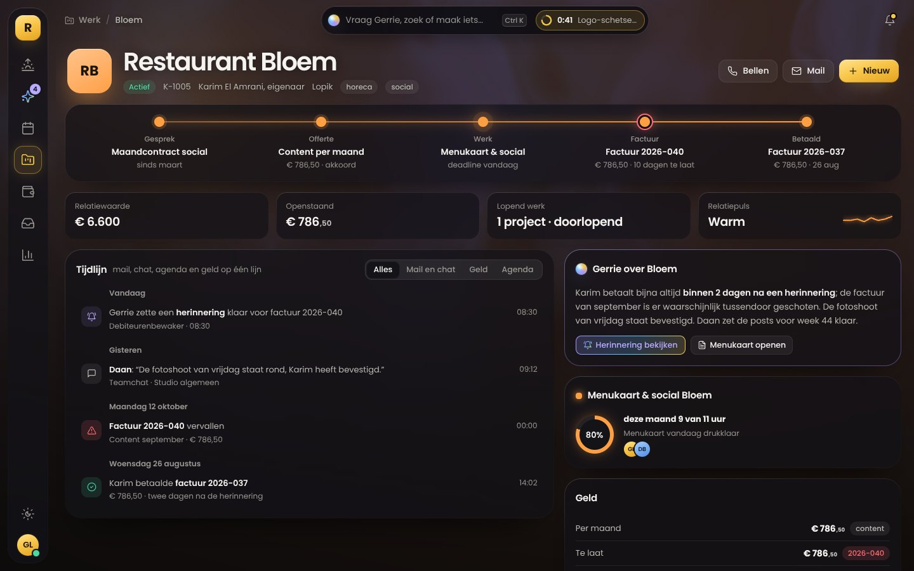 | 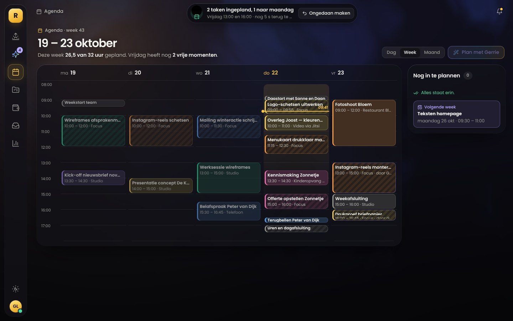 |
| 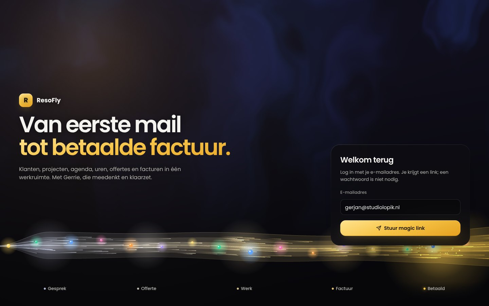 | 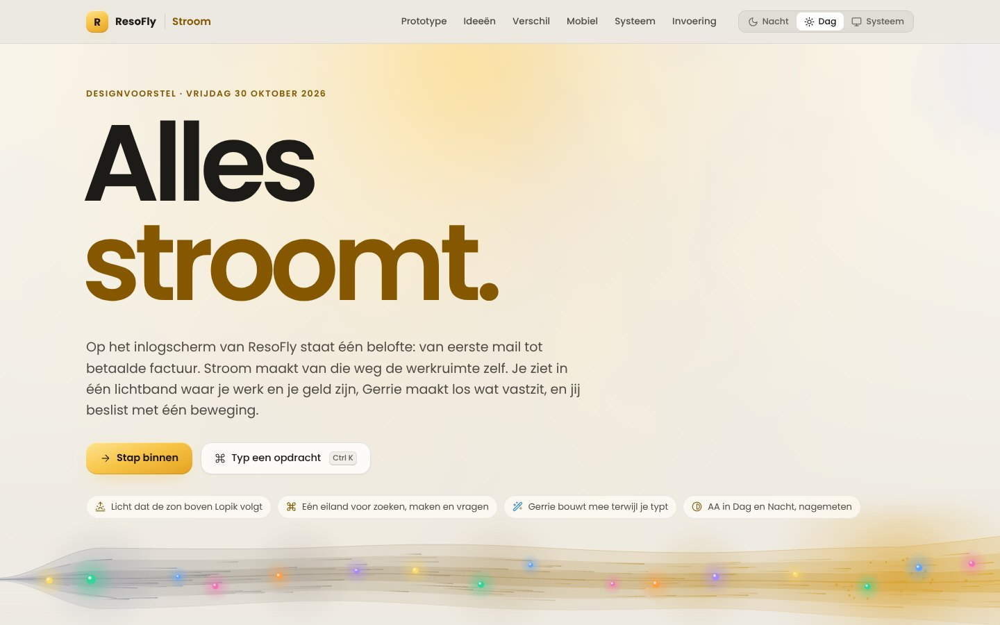 |

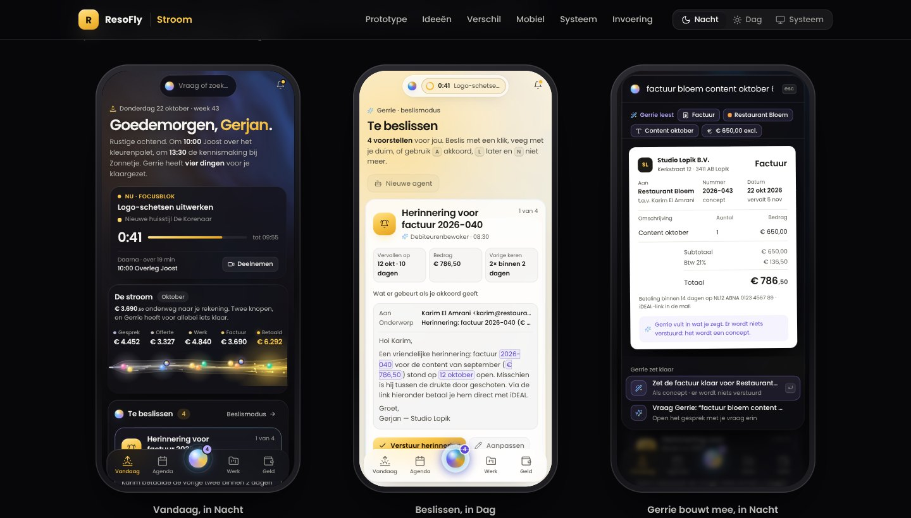

Het prototype is één en hetzelfde op elk formaat: met container queries kiest het zelf zijn
telefoonopbouw (het eiland bovenin, een dock met het orbje van Gerrie in het midden). De telefoons
in het voorstel zijn dus geen plaatjes, maar drie levende instanties van 390 breed.

## Wat er verandert, en wat blijft

Gemeten aan Zenit met Onbewolkt, zoals die nu achter **Probeer Zenit** in de app staat.

| onderdeel | Zenit nu | Stroom |
|---|---|---|
| Menu | Nachtrail met zeven modules en een contextpaneel | Dezelfde zeven modules in een rail van glas; wat erin zit, verschijnt naast de rail als je erop wijst. Het werkvlak krijgt de breedte van het paneel terug |
| Zoeken en maken | Vraagbalk in de tabrij; een vraag opent het gesprek met Gerrie | Het eiland: zoeken, springen, maken en vragen, met het antwoord in het eiland zelf |
| Een opdracht | *factuur bloem 650* gaat als vraag naar Gerrie | Het eiland ontleedt de opdracht en bouwt de factuur live; Enter zet hem als concept klaar |
| Vandaag | Dagboog, Je dag, Aandacht en Meer van vandaag | De stroom, de beslisstapel, Je dag en de Nu-kaart. De zon zit in het licht, niet meer in een grafiek |
| Wat nu loopt | De timer in de urenmodule, meldingen apart | Live in het eiland: de timer, Gerrie die werkt, de tien seconden om terug te halen |
| Beslissen | Een lijst met kaarten op de pagina van Gerrie | Een stapel op Vandaag en in de beslismodus; vegen werkt ook met de muis; elke beslissing raakt de stroom |
| Klant | De kop krijgt de kleur van de klant als gloed | Het hele licht kleurt mee, met de stroomlijn van de klant bovenaan |
| Facturen | Een lijst; het spiekpaneel stond nog open | De geldstroom erboven (saldo € 14.380, over 30 dagen € 17.990); een factuur groeit uit tot papier naast de lijst |
| Agenda | De weekplanner | Dezelfde week, met *Plan met Gerrie* en slepen op een kwartier nauwkeurig |
| Vlakken | Grafiet en papier met een glansrand | Glas op een lichtveld (WebGL, met CSS-terugval) |
| Blijft | | Het R-merkteken, grafiet en zongoud, het poollicht, Poppins, de zeven modules, de rechten per module, Dag, Nacht en Met de zon mee, en de huisstijl van de klant op portaal, offertes en facturen |

## Tokens

Alles staat in `bron/tokens.mjs`, per token `[Nacht, Dag]`; de build schrijft er de blokken voor
Nacht (standaard), Dag (systeem) en Dag (gekozen) uit. De merk-, tekst- en statuskleuren zijn die van
Belicht en Zenit. Inkt 2 en 3 zijn een tikje steviger gemaakt voor glas. Nieuw zijn:

| token | Nacht | Dag | waarvoor |
|---|---|---|---|
| `--glass` · `--glass-2` · `--glass-3` | grafiet 72% · 82% · 88% | wit 64% · 80% · 90% | kaart · stapel en menu's · eiland en wat zweeft |
| `--glass-blur` | `blur(26px) saturate(150%)` | `blur(26px) saturate(185%)` | het matglas |
| `--lf-base` · `--lf-top` | `#07070A` · `#100F1C` | `#EDEAE3` · `#F8F5EE` | de grond van het lichtveld |
| `--lf-sun` · `--lf-a1` · `--lf-a2` | `#F7C548` · `#4B3BC4` · `#14609F` | `#FFD670` · `#D9CFFF` · `#CBE4FF` | zon, poollicht violet en blauw |
| `--flow-1` → `--flow-2` | `#AEB6D0` → `#F7C548` | `#7E859C` → `#D99A12` | de stroom: maanlicht wordt zongoud |
| `--focus` | `#F7C548` | `#855800` | de focusring (in Dag goud-als-tekst, zodat hij 3:1 haalt) |
| `--on-ai` · `--hello-fill` · `--field-shadow` | | | tekst op poollicht · de naam in de groet · tekst los op het licht |

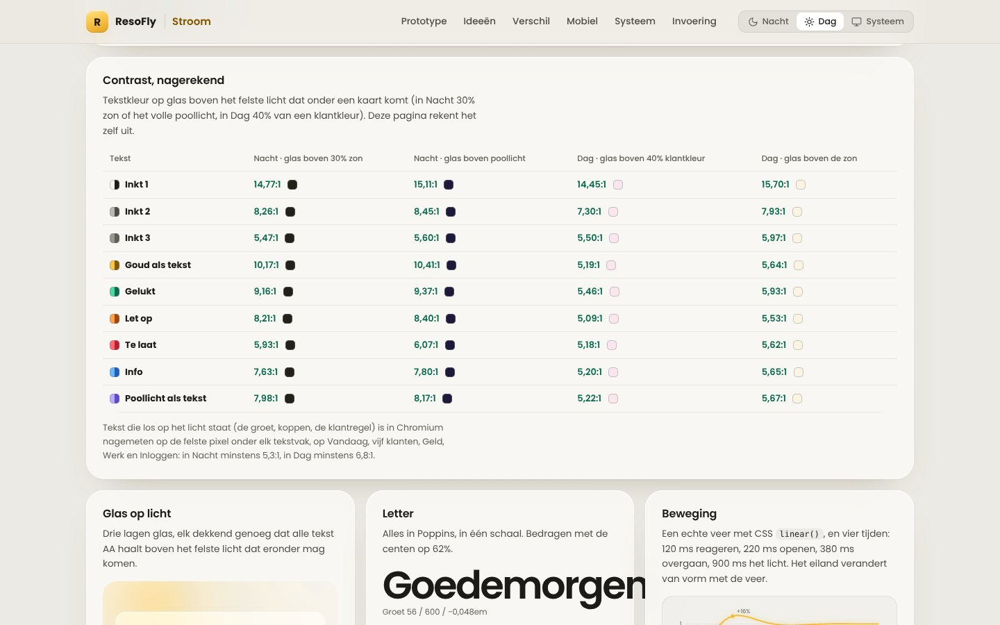

**Contrast.** Elke tekstkleur haalt AA (≥ 4,5:1) op glas boven het felste licht dat onder een kaart
mag komen: in Nacht 30% zon of het volle poollicht, in Dag 40% van de donkerste klantkleur. De
voorstelpagina rekent dat zelf na (laagste: *Let op* in Dag, 5,09:1). Tekst die los op het licht
staat (de groet, koppen, de klantregel) is in Chromium nagemeten op de felste pixel onder elk
tekstvak, op alle schermen en bij alle zes klanten: in Nacht minstens 5,32:1 (De Korenaar), in Dag
minstens 6,78:1 (Zonnetje). Daarvoor staat in Nacht de zon links als
gloed en komt het poollicht van rechts, weg van de koppen.

**Vorm:** hoeken 6 · 9 · 12 · 16 · 20 · 26 · 32. **Diepte:** lichtveld → glas → zwevend; in Nacht
licht van boven (een glansrand), in Dag een warme schaduw. **Beweging:** 120 ms reageren, 220 ms
openen, 380 ms overgaan, 900 ms het licht; het eiland met een veer in `linear()` (16% doorschieten,
na 0,6 s rust). Alles uit bij *minder beweging*.

**Letter.** Alles in Poppins: groet 56/600 (−0,048em), titel 32/600, bedrag 22/600 met de centen op
62%, kaarttitel 15/600, tekst 13,5/400. Bedragen staan altijd voluit.

## Toekomstbestendig

- **Webstandaarden, geen nieuwe bibliotheken:** View Transitions met `view-transition-class`,
  `linear()`-veren, `@property`, container queries, `:has()`, `color-mix()` en `backdrop-filter`,
  op de huidige React 18-app.
- **Zuinig:** het lichtveld tekent op een derde van de resolutie, met hooguit 30 beelden per
  seconde, en staat stil buiten beeld en in een verborgen tabblad. De stroom tekent alleen licht; de
  kralen zijn gewone knoppen. Zonder WebGL tekent CSS dezelfde kleuren.
- **Klaar voor agents:** het eiland is een gezicht op de handelingenregistry van Gerrie; wat je daar
  kunt, kunnen de agents, de MCP-koppeling en de openbare API ook klaarzetten. Niets gaat de deur uit
  zonder akkoord.
- **Toegankelijk als ondergrens:** AA in beide thema's, ook boven het licht; zichtbare focus; alles
  met het toetsenbord; de stroom heeft knoppen en tekst voor de schermlezer.

## Invoeren in vijf stappen

Zoals Zenit: eerst achter een schakelaar **Probeer Stroom** per gebruiker, naast de huidige look.

1. **Fundament.** `src/styles/stroom.css` met de tokens uit `bron/tokens.mjs`, geladen ná
   `zenit.css`; de look `stroom` in `src/lib/look.ts`; `LightField.tsx` (WebGL met CSS-terugval) en
   het opstartscript in `index.html`. Let op de CSP-hash (`node scripts/check-csp-hash.mjs`).
   *Klaar als* beide thema's AA halen en `npm run test:mobile -- --look=stroom --theme=both` groen is.
2. **Het eiland.** `StroomIsland.tsx` op `GlobalSearch.tsx` en `askGerrie()`; de opdracht ontleden
   via de handelingenregistry in `gerrie-api.ts`; live in het eiland de timer uit `TimeTracking.tsx`
   en het ongedaan maken uit de beslislijst (`decisions-api.ts`). *Klaar als* zoeken, springen, maken
   en vragen met het toetsenbord werken en een mail tien seconden terug te halen is.
3. **Vandaag.** `StreamRibbon.tsx` (canvas plus kraal-knoppen) met de haltes uit offertes, projecten
   en facturen; de stapel op `DecisionFeed.tsx`; Je dag uit `DashboardCalm.tsx`. *Klaar als* elk
   bedrag in de stroom gelijk is aan het overzicht in Geld.
4. **Modules.** Klant 360 met stroomlijn (`Clients.tsx`), Geld met geldstroom en papier
   (`Finance.tsx`, `FinanceDocPreview.tsx`), Agenda met *Plan met Gerrie* (`WeekPlanner.tsx`) en de
   beslismodus (`GerrieCommandCenter.tsx`); daarna module voor module de rest.
5. **Telefoon en buitenkant.** De dock met het orbje en het eiland bovenin (`BottomNav.tsx`).
   Portaal, offertes en facturen houden de huisstijl van de klant (`brandThemeVars`).

## Keuzes

Op 30 oktober akkoord gegeven op alle vijf. Stroom staat sindsdien in de app; wat er is
gebouwd en wat nog niet, staat in `CHANGELOG_STROOM_2026-10-30.md`.

| vraag | advies | gekozen |
|---|---|---|
| Heet het Stroom, en komt het achter een schakelaar *Probeer Stroom*? | Ja, zoals Zenit | ja, gebouwd |
| Wordt de stroom het hart van Vandaag, in plaats van de Dagboog? | Ja; de zon zit in het licht en de dag staat als lijst naast de stapel | ja, gebouwd |
| Werktabs: in het eiland (*Recent*) of als rij bovenin? | In het eiland, met <kbd>⌃Tab</kbd> om te wisselen; de bovenregel blijft rustig | in het eiland, gebouwd |
| Het lichtveld: WebGL voor iedereen, of CSS op zuinige apparaten? | WebGL waar het kan; CSS bij batterijbesparing en bij minder beweging | zo gebouwd |
| Hoe rollen we uit? | Twee weken *Probeer Stroom* voor het eigen team, dan voor iedereen; Zenit blijft kiesbaar tot Stroom de standaard is | zo afgesproken; staat op staging |

## Nog niet in het voorstel

Berichten en Inzicht tonen alleen hoe ze worden; Instellingen, *Aanpassen* op een voorstel, en de
lenzen Projecten, Planningstimeline, Tickets, Archief, Inkoop, Bank, Boekhouding en Rapportage zijn
niet uitgewerkt (ze staan wel in het menu, met *later*). Gerrie kent in het prototype vier
onderwerpen (Restaurant Bloem, je vrijdag, je geld en De Korenaar); in de app beantwoordt hij elke
vraag over je eigen administratie.

## Hoe het gecontroleerd is

- Gebouwd als één zelfstandig HTML-bestand van 337 KB (Poppins via Google Fonts, iconen uit Lucide
  0.408, dezelfde versie als `lucide-react` in de app). `bron/build.mjs` bouwt het opnieuw.
- Een functionele ronde in Chromium (Playwright), 29 controles, alle groen: <kbd>Ctrl</kbd>+<kbd>K</kbd>
  opent het eiland; *factuur bloem content oktober 650* wordt in vier stukken ontleed en rekent
  € 786,50; Enter zet concept 2026-043 klaar en hij staat daarna in Geld; <kbd>A</kbd> geeft akkoord met
  tien seconden aftellen, de stapel gaat naar *1 van 3*, de knoop wordt *opgevolgd* en *Ongedaan
  maken* zet alles terug; *Karim betaalt* telt Betaald op tot € 7.078,50 en zet 2026-040 op betaald;
  <kbd>G</kbd> <kbd>F</kbd> opent Geld; een factuur opent als papier; Restaurant Bloem toont de knoop
  in de stroomlijn; Gerrie beantwoordt een vraag in het eiland en plant twee taken op vrijdag en de
  derde op maandag; Dag en Nacht wisselen; volledig scherm en <kbd>Esc</kbd>; drie levende telefoons.
  Geen fouten in de console.
- Het contrast van tekst die los op het licht staat, nagemeten op de felste pixel onder elk tekstvak:
  24 metingen (Vandaag, Gerrie, Agenda, Werk, Geld, Inloggen en alle zes klanten, in Nacht en Dag),
  alle boven AA (zie *Tokens*).
- Bekeken op 1440 × 900, 1024 × 768 en 390 × 844, in Nacht en Dag, en met *minder beweging*: de
  pagina scrollt nergens horizontaal.
- Het voorstel raakt `src/` niet aan.

## Online

Gepubliceerd als Artifact: https://claude.ai/artifact/WJieZCTqA4iCzNpCBeRb1i (privé; deel het via het Share-menu).
