# Designvoorstel — ResoFly Zenit — 2026-10-22

## De vraag

> Acteer als een next level senior designer. Ontwerp een nieuwe front end voor Resofly. Ik wil een
> moderne look en feel, met behoud van de branding. Lettertype poppins, maar next level design.
> Maximale UX. Men moet het idee hebben op een toekomst bestendig platform te opteren. Doe me een
> next level voorstel en verras me positief. Ik wil een dark en light thema uiteraard.

Dit is het voorstel, nog niet ingebouwd. De invoering staat onderaan, met vier keuzes die eerst
gemaakt moeten worden.

## Bekijken

| wat | waar |
|---|---|
| Werkend prototype met het hele voorstel: zes schermen, de Dagboog, de vraagbalk, beslissen, het spiekpaneel, telefoons, het systeem en de invoering | `docs/design-voorstel-zenit/index.html` (dubbelklikken), of online: https://claude.ai/artifact/MqESGc9Vs7h973tJ1a9N8f (privé; deel het via het Share-menu) |
| Beelden van elk scherm in Nacht en Dag | `docs/design-voorstel-zenit/beelden/` |
| De bron, met één tokenbron voor alle kleuren | `docs/design-voorstel-zenit/bron/` (`node docs/design-voorstel-zenit/bron/build.mjs`) |

De schermen gebruiken de voorbeeldgegevens uit de testomgeving (`tests/mobile/mock/seed.mjs`):
Studio Lopik, Bakkerij De Korenaar, Restaurant Bloem, factuur 2026-040, enzovoort. De demo speelt
op donderdag 22 oktober 2026 om 09:41.

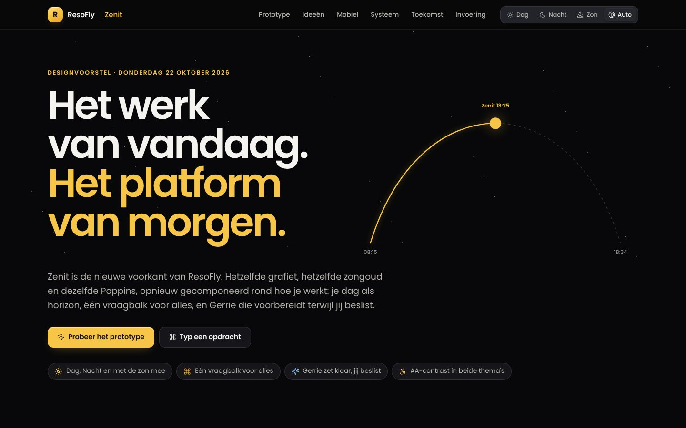

## Het idee

**Zenit** is het hoogste punt van de zon. Het merk van ResoFly is al licht: zongoud, Dag en Nacht,
het poollicht van Gerrie. Zenit maakt daar één beeld van. Je werkdag is een horizon, de zon is
*nu*, het poollicht is alles wat Gerrie voor je klaarzet, en Dag en Nacht zijn dezelfde lucht op
een ander uur.

Het merk zelf verandert niet: het R-merkteken, grafiet en zongoud, het poollicht en Poppins blijven
precies zoals ze zijn. Wat verandert is de opbouw van de werkruimte en hoe je erin werkt.

## Zes ideeën

1. **Je dag als horizon — de Dagboog.** Afspraken en focusblokken liggen op de baan van de zon
   boven Lopik (vandaag op om 08:15, zenit om 13:25, onder om 18:34). Eronder altijd *nu* en
   *volgende*, met de knop die je dan nodig hebt: deelnemen, route of bellen. Sleep de zon of speel
   de dag af; groet, nu en volgende bewegen mee.
2. **Eén vraagbalk voor alles (⌘K of /).** Zoeken, springen, maken en Gerrie iets vragen op één plek,
   in gewone taal. *factuur bloem content oktober 650* wordt zichtbaar ontleed (klant, omschrijving,
   bedrag) en staat met één Enter als concept klaar. Er wordt niets verstuurd.
3. **Gerrie zet klaar, jij beslist.** Elk voorstel komt met *waarom nu* (de feiten) en *wat er
   gebeurt* (de mail, de uren, de boeking). Akkoord, later of niet meer, met een klik of met
   <kbd>A</kbd>, <kbd>L</kbd>, <kbd>N</kbd>. Een mail gaat pas na tien seconden de deur uit, zodat
   ongedaan maken echt kan.
4. **Blijf waar je bent — het spiekpaneel.** Een factuur, taak of klant opent naast de lijst in
   plaats van op een nieuwe pagina. Werktabs blijven voor wat je langer open wilt houden.
5. **De klant in één oogopslag.** Eén tijdlijn met mail, chat, agenda, offertes en facturen, de
   relatiepuls, en wat Gerrie over de klant weet, met de volgende stap als knop.
6. **Met de zon mee.** Naast Dag, Nacht en Systeem een stand die de echte zon volgt: overdag Dag, na
   zonsondergang Nacht. De nacht valt als een cirkel vanuit de zon (View Transitions).

| Nacht | Dag |
|---|---|
| 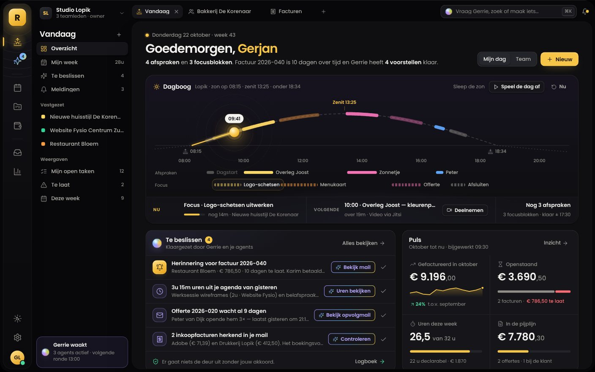 | 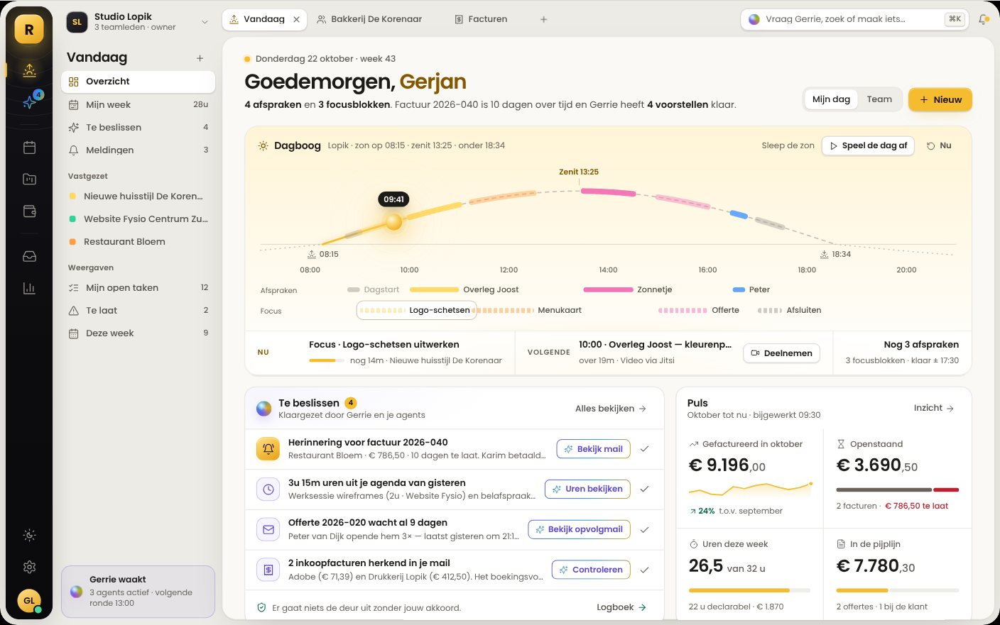 |
| 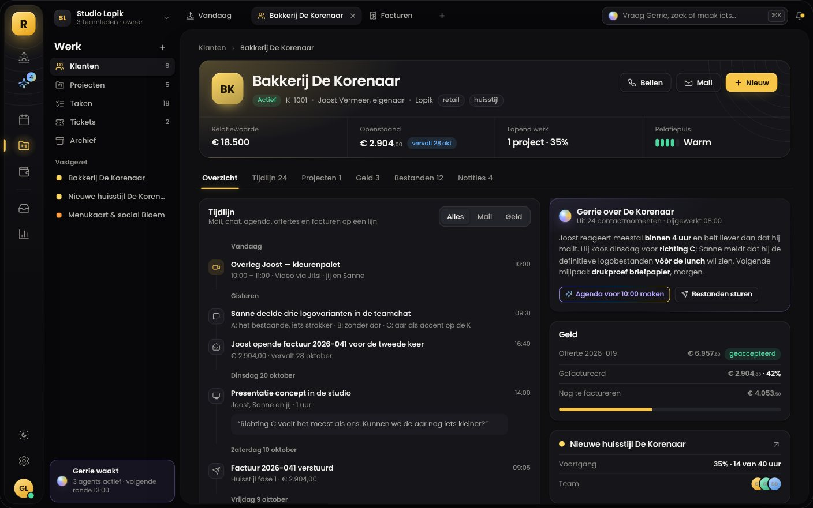 | 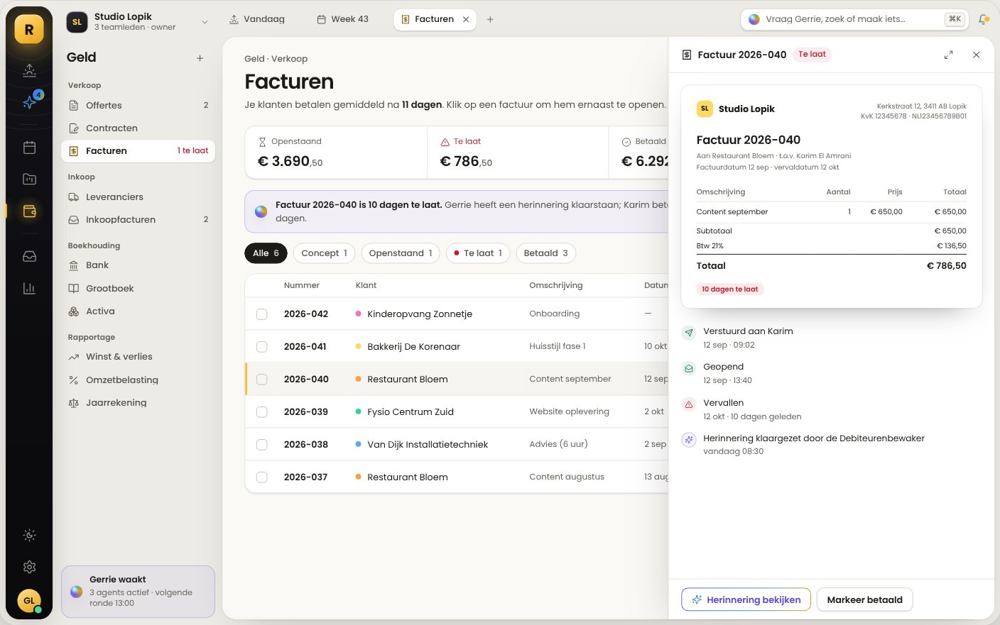 |
| 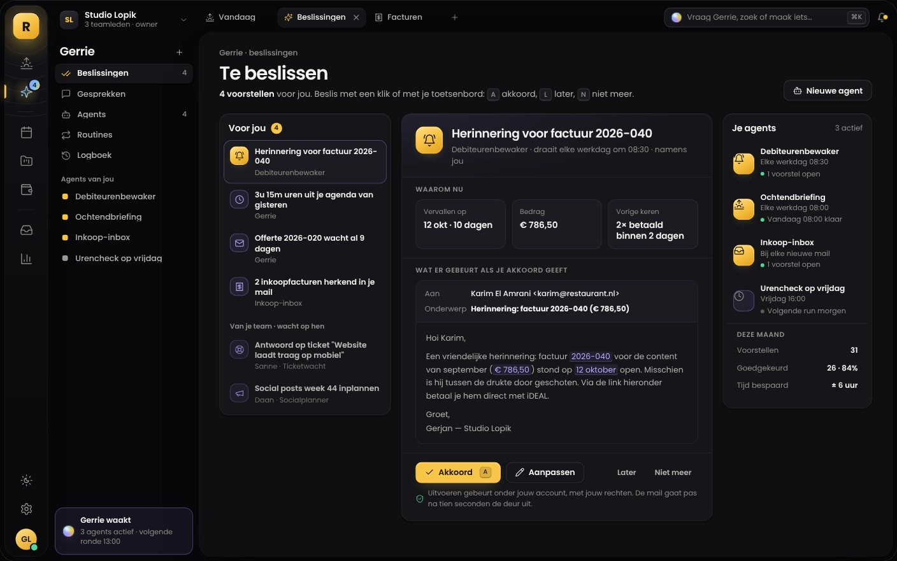 | 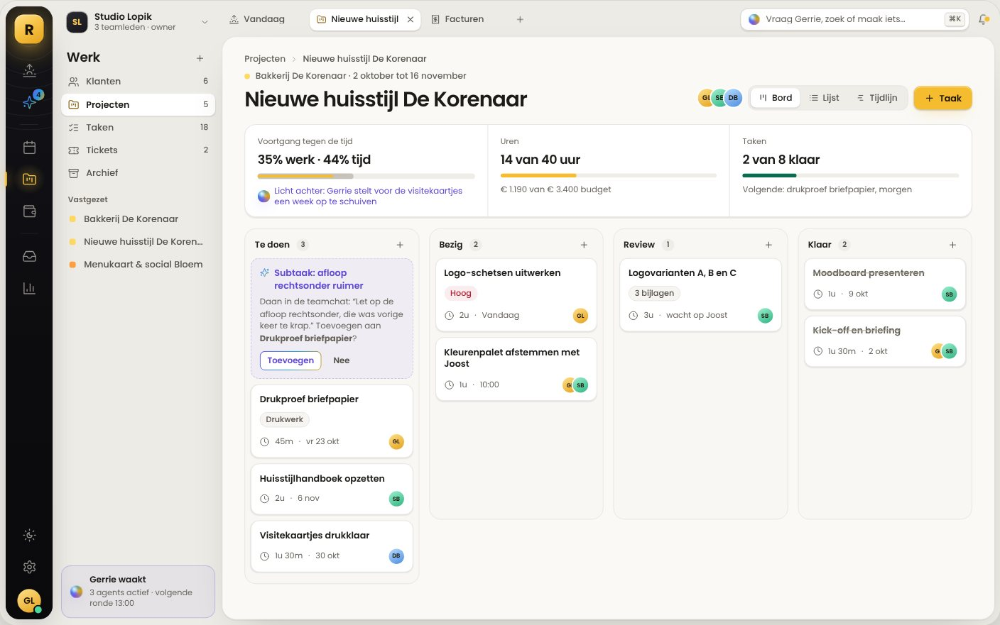 |
| 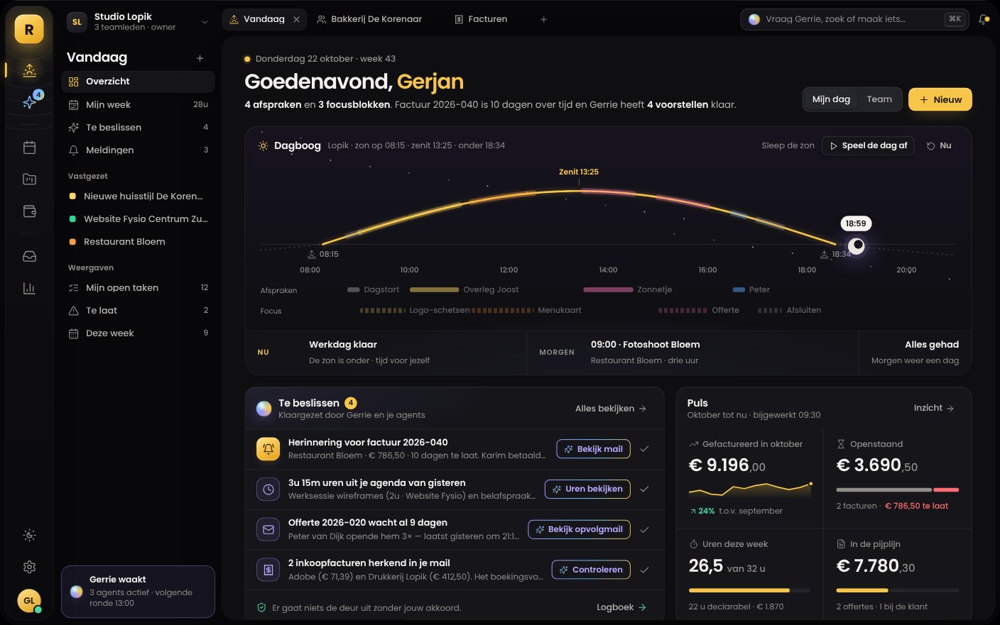 | 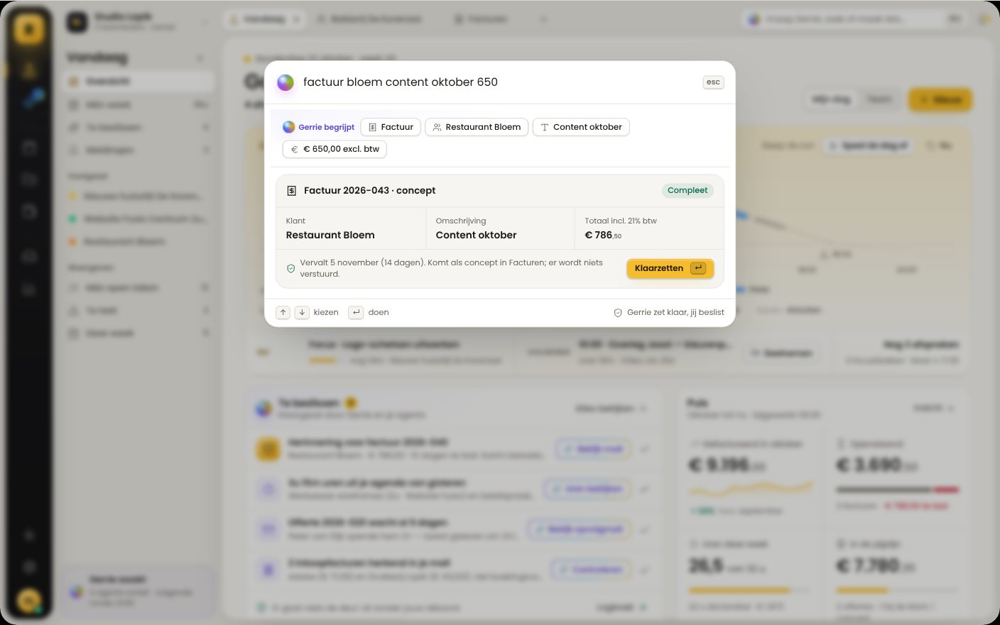 |

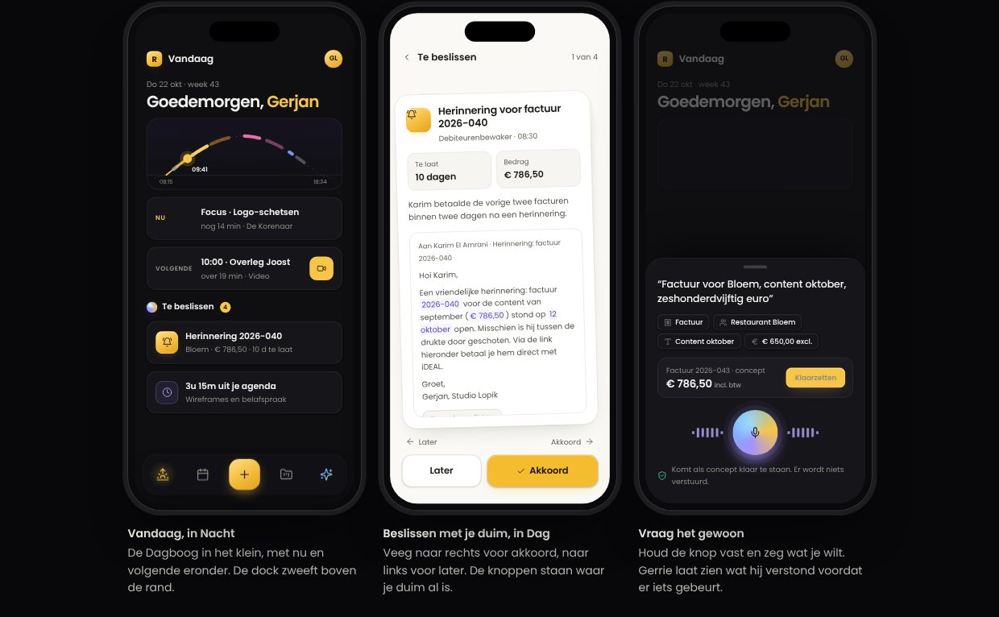

## Wat er verandert, en wat blijft

Gemeten aan de werkruimte zoals die nu op staging staat (met de Cockpit-laag van 2026-10-05).

| onderdeel | nu | Zenit |
|---|---|---|
| Menu | Eén zijbalk met zes groepen; Financiën klapt uit tot vijftien regels | **Nachtrail** met zeven modules (Vandaag, Gerrie, Agenda, Werk, Geld, Berichten, Inzicht), plus een **contextpaneel** per module met vastgezette klanten en weergaven |
| Zoeken en maken | Zoekveld in de zijbalk, maken per pagina, Gerrie als zwevende knop | Eén **vraagbalk** voor zoeken, springen, maken en vragen |
| Dashboard | Cockpit met zes kerncijfers en het weekspoor | **Vandaag**: Dagboog, Te beslissen, Puls (vier cijfers in één kaart), taken en Geldstroom |
| Gerrie | Commandocentrum met beslislijst, chat en agents | Een laag door de hele app: voorstellen staan waar je ze nodig hebt, in het poollicht |
| Details openen | Een nieuwe pagina of een venster | Het **spiekpaneel** naast de lijst |
| Thema | Donker of Licht in het accountmenu | **Dag, Nacht, Met de zon mee of Systeem**, plus Ruim of Compact |
| Blijft | | Het R-merkteken, grafiet en zongoud, het poollicht, Poppins, werktabs, de rechten per module, en de huisstijl van de klant op portaal, offertes en facturen |

De nachtrail is in beide thema's donker: het merkanker en de herkenning van de huidige Cockpit.
Het werkvlak, het paneel en de kaarten volgen het thema.

## Tokens

Elke tekstkleur haalt WCAG AA (≥ 4,5:1) op kaart, werkvlak én grond, in beide thema's. De
voorstelpagina rekent dat zelf na op de kleuren die je ziet (sectie *Systeem*). De merk-, tekst- en
statuskleuren zijn die van Belicht. Bijgesteld zijn de vlakken (in Nacht een fractie koeler, in Dag een
diepere grond) en inkt 3 in Dag.

| token | Nacht | Dag | |
|---|---|---|---|
| grond | `#08080A` | `#EDEBE5` | was `#09090A` / `#F1F0EC`; in Dag dieper, zodat het papier erop ligt |
| werkvlak | `#0F0F12` | `#FAF9F6` | Nacht was `#0F0F11` |
| kaart · verhoogd · ingedrukt | `#15151A` · `#1B1B21` · `#23232A` | `#FFFFFF` · `#F6F5F1` · `#EEEDE8` | Nacht was `#141417` · `#1A1A1E` · `#212126` |
| inkt 1 · 2 · 3 | `#F4F3F0` · `#B5B3AD` · `#908E88` | `#1C1B18` · `#55524B` · **`#67635B`** | inkt 3 in Dag was `#6F6B63`: 4,45:1 op de grond, nu 5,0:1 |
| zongoud (vulling) · als tekst · tekst op goud | `#F7C548` · `#F7C548` · `#1A1405` | `#F4BC2E` · `#855800` · `#1C1405` | |
| gelukt · let op · te laat · info | `#4CD9A0` · `#FFA24C` · `#FF6B72` · `#6CB6FF` | `#0B6B4E` · `#A3470A` · `#BD1F31` · `#1A5FBA` | |
| poollicht · als tekst | `#A392FF` → `#6CC4FF` → `#F7C548` · `#B8AAFF` | `#6E5AE6` → `#1F9BE0` → `#E0A11B` · `#5E48D6` | |
| lucht van de Dagboog | `#16131F` → `#0F0F12`, met sterren | `#FFF4D6` → `#FFFDF8` | nieuw: `--sky-1`, `--sky-2`, `--sky-haze`, `--star` |

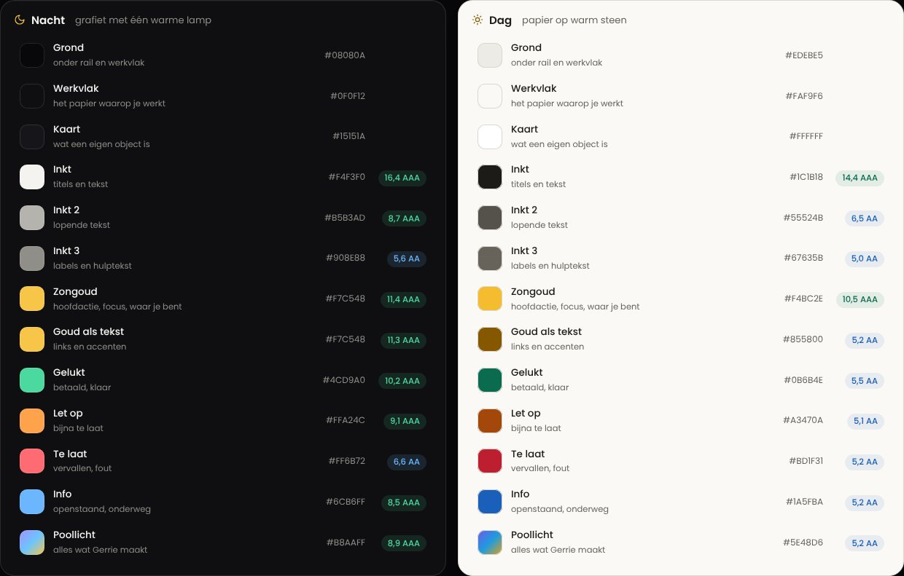

**Vorm:** hoeken 6 · 8 · 10 · 14 · 16 · 20, binnen elkaar concentrisch. **Diepte:** grond →
werkvlak → kaart → zwevend; in Nacht licht van boven (een glansrand), in Dag een zachte schaduw.
**Beweging:** 120 ms (reageren), 200 ms met veer (openen), 320 ms (overgaan), 700 ms (de
thema-overgang vanuit de zon); alles uit bij *minder beweging*.

## Letter

Alles in **Poppins**, in één schaal: display 64/600 (−0,04em), titel 30/600, kop 19/600, kaarttitel
14,5/600, tekst 13,5/400 (regelhoogte 1,5), label 12/500. Bedragen 25/600 met de centen op 62%.
Poppins heeft geen tabelcijfers; bedragen onder elkaar lijnen daarom rechts uit.

## Toekomstbestendig

- **Eén tokenbron** in drie lagen (merk → betekenis → component). In het voorstel is dat
  `bron/tokens.mjs`; in de app wordt het `src/styles/zenit.css` naast de bestaande THEMA-TOKENS.
- **Agent-klaar** (staat al): wat je in de app kunt, kan een agent klaarzetten, via Gerrie, de
  MCP-koppeling en de openbare API. De vraagbalk maakt die handelingenregistry zichtbaar.
- **Ruimte voor modules:** de rail heeft plek, elk contextpaneel groeit mee. Een nieuwe module
  (zoals de BV- en VPB-module) maakt het menu niet langer.
- **Moderne webstandaarden** in plaats van extra bibliotheken: View Transitions, container queries
  en `:has()`, op de huidige React 18-app.
- **Toegankelijk als ondergrens:** AA in beide thema's, zichtbare focus, kleur nooit de enige drager
  van betekenis, alles met het toetsenbord.

## Invoeren in vijf stappen

Zenit komt eerst achter een schakelaar **Probeer Zenit** per gebruiker, naast de huidige look.

1. **Fundament** — tokens in `src/styles/zenit.css` (geladen ná `cockpit.css`), de letterschaal, en
   de vier themastanden in `src/lib/theme.ts` (`'dark' | 'light' | 'sun' | 'system'`) plus het
   opstartscript in `index.html`. Let op: dat script valt onder de CSP-hash
   (`node scripts/check-csp-hash.mjs`). *Klaar als* beide thema's AA halen en
   `npm run test:mobile -- --theme=both` groen is.
2. **Werkruimte** — nachtrail en contextpaneel (`Sidebar.tsx`), werktabs (`TabBar.tsx`), de vraagbalk
   op de handelingenregistry van Gerrie (`GlobalSearch.tsx`, `gerrie-api.ts`) en het spiekpaneel.
3. **Vandaag** — Dagboog, Te beslissen (`DecisionFeed.tsx`), Puls en Geldstroom in `Dashboard.tsx`.
4. **Modules** — Klant 360 (`Clients.tsx`), projectbord (`Projects.tsx`), facturen met spiekpaneel
   (`Finance.tsx`), agenda (`CalendarPage.tsx`) en Gerrie (`GerrieCommandCenter.tsx`); daarna module
   voor module de rest.
5. **Mobiel en buitenkant** — dock, onderbladen en spraak. Portaal, offertes en facturen houden de
   huisstijl van de klant (`brandThemeVars`).

## Keuzes

| vraag | advies | gekozen |
|---|---|---|
| Heet het Zenit (ontwerp en schakelaar)? | Ja | ja (2026-10-23: "geef me de look en feel") |
| Rail in Dag donker of licht? | Donker: merkanker en herkenning | zo ingebouwd; nog te bevestigen |
| Welk thema als standaard voor nieuwe gebruikers? | Met de zon mee; een eigen keuze blijft staan | open: de standaard is nog Nacht, Met de zon mee is te kiezen |
| Hoe uitrollen? | Twee weken *Probeer Zenit* voor het eigen team, dan voor iedereen | de schakelaar staat erin; wie hem aanzet is aan jou |

## Ingebouwd (2026-10-23)

Stap 1 t/m 3 staan in de app, achter **Probeer Zenit** in het accountmenu: de tokens, de vier
themastanden, de nachtrail met contextpaneel, de vraagbalk (zoeken + *Vraag Gerrie*), het
zwevende werkvlak en Vandaag met de Dagboog en de Puls. Nog niet: het spiekpaneel, de
Geldstroom, de vraagbalk die een opdracht ontleedt, de <kbd>G</kbd>-sneltoetsen en Ruim/Compact.
Alles staat in `CHANGELOG_ZENIT_2026-10-23.md`.

## Hoe het gecontroleerd is

- Gebouwd als één zelfstandig HTML-bestand (Poppins via Google Fonts, iconen uit Lucide 0.408,
  dezelfde versie als `lucide-react` in de app). `bron/build.mjs` bouwt het opnieuw, byte voor byte.
- Met Chromium (Playwright) bekeken op 1440 × 900 en op 390 breed, in Nacht en Dag: geen fouten in
  de console, geen horizontaal scrollen op de telefoon.
- Functioneel nagelopen: ontwerpnotities 1 t/m 9, een taak afvinken, <kbd>G</kbd> <kbd>G</kbd> naar
  Gerrie en vier keer <kbd>A</kbd> tot *Alles beslist*, een kaart naar een andere kolom slepen, de
  vier themastanden, en de vraagbalk met *factuur*, *offerte*, *taak*, *afspraak*, *uren*, zoeken en
  een vraag.
- De zonnetijden zijn berekend voor Lopik (51,97° N, 4,94° O) op 22 oktober 2026 (NOAA-benadering,
  zomertijd): op 08:15, zenit 13:25, onder 18:34.
- Het voorstel zelf (`docs/design-voorstel-zenit/`) raakt `src/` niet aan. De inbouw in de app
  kwam een dag later, met zijn eigen controles: zie `CHANGELOG_ZENIT_2026-10-23.md`.
