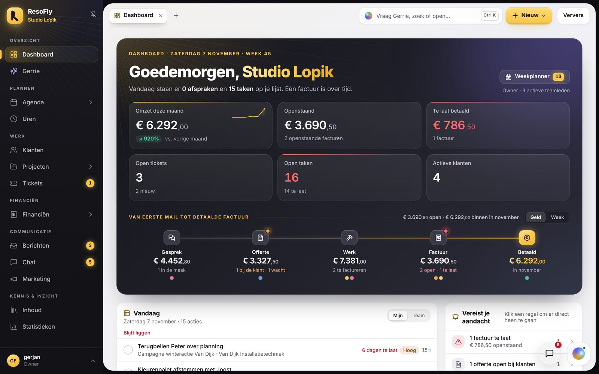
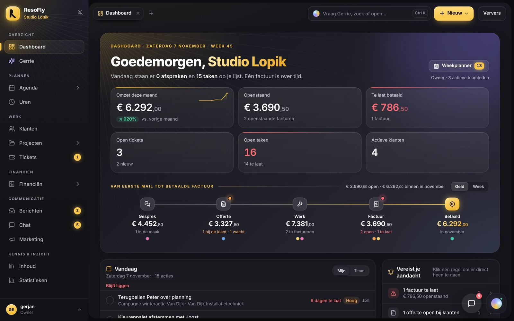
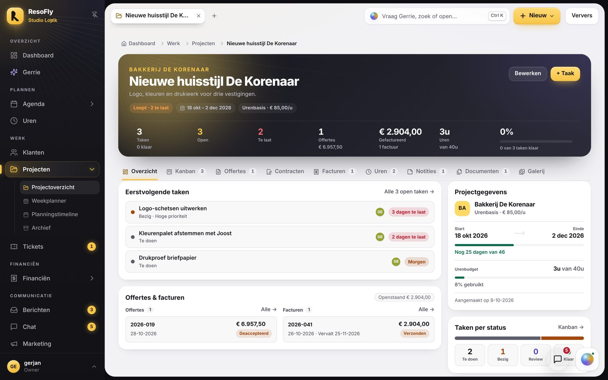
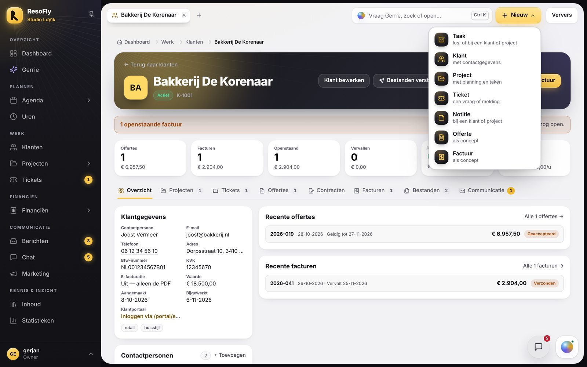
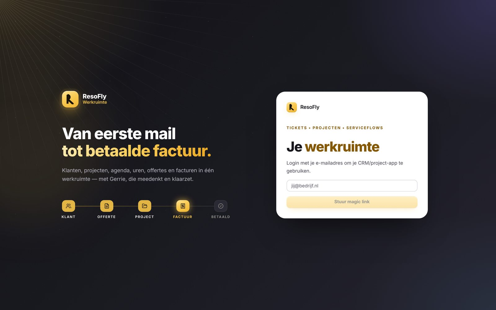
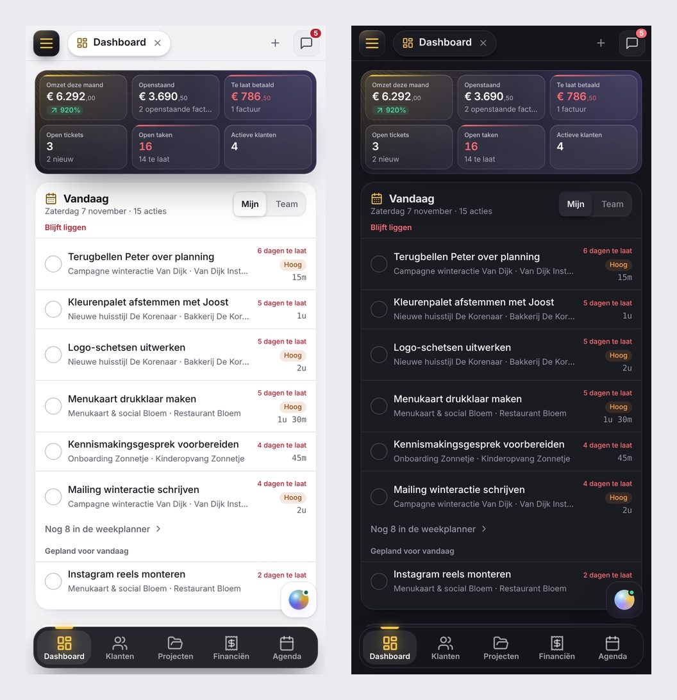

# Baken: de opbouw en de contrasten van Value Backlog, in het merk van ResoFly (2026-11-06)

## Wat de PO vroeg

> Kijk naar het design van de value backlog app (alleen look en feel van de portal).
> Ik wil hetzelfde realiseren voor Resofly. Zelfde contrasten en opzet, maar dan wel met de
> branding van Resofly zelf.
>
> Wees maximaal creatief en plaats op staging een nieuw design waarmee je mij omverblaast zo
> mooi. De werking van de app mag er uiteraard niet aan lijden.

## In het kort

**Baken** is de nieuwe standaardlook van de werkruimte. Hij neemt van Value Backlog (repo
`dexpresso-ai/value-backlog`) de twee lagen over: een diep donker commandovlak (de zijbalk, de
cockpit, de koppen) en een licht werkvlak met witte kaarten dat daarop zweeft. Eén felle kleur is
het signaal. Bij Value Backlog is dat neon mint op navy; bij ResoFly is het **zongoud op
nachtgrafiet**, met het poollicht van Gerrie als tegenlicht.

Cockpit (de vorige standaard), Zenit en Stroom blijven kiesbaar: accountmenu → **Weergave**.

| Nacht | Een project |
|---|---|
|  |  |
|  |  |

## Wat Value Backlog doet, en Baken nu ook

| Value Backlog | Baken |
|---|---|
| Navy geeft diepte, mint is het signaal | Nachtgrafiet geeft diepte, zongoud is het baken (daar komt de naam vandaan) |
| Een licht, koel canvas met witte kaarten | Hetzelfde: werkvlak `#F2F2F5`, witte kaarten met een zachte grafietschaduw |
| De cockpit is lichter dan de zijbalk | Ook: de cockpit loopt van `#15151B` naar `#2C2B39`, de zijbalk blijft dieper |
| Een mint gloed linksboven | De gouden lamp linksboven, en rechts het poollicht van Gerrie |
| De honingraat van het fasebord als textuur | Lichtstralen die vanuit het merk uitwaaieren (Cockpit had ringen) |
| Bovenbalk: zoeken met ⌘K, **Nieuwe taak**, meldingen | Tabrij met de werktabs, zoeken met Gerrie (Ctrl/⌘K) en een gouden **+ Nieuw** |
| In de cockpit het fasespoor | In de cockpit de weg van het geld: Gesprek, Offerte, Werk, Factuur, Betaald |
| Paginakop met het icoon in een navy tegel | Paginakop met het icoon in een tegel van nachtgrafiet, het icoon in goud |
| Op de telefoon een zwevende dock | Dezelfde dock (al sinds Cockpit), in nachtgrafiet |

## Wat er nieuw is

### Het merk zelf

- **Het R-merkteken** uit het app-icoon staat nu in de tegel, in plaats van een R in Poppins
  (`src/components/BrandMark.tsx`). Het is nagetekend op hetzelfde raster van 512: de inkeping
  bovenaan, de smalle spleet tussen stam en boog en het schuine been. De tegel ziet er daardoor
  precies zo uit als het icoon op je telefoon. Ook op het inlogscherm.
- **Nachtgrafiet**: het grafiet van ResoFly met een vleug nacht-violet. Het donker heeft daardoor
  diepte, zoals het navy van Value Backlog, zonder blauw te worden. Het violet is dat van het
  poollicht van Gerrie.

### Het werkvlak

- **Dag is in Baken de standaard.** Dat zijn de contrasten van Value Backlog: een licht werkvlak
  met het donker in de zijbalk, de cockpit en de koppen. Wie ooit zelf Donker of Licht koos, houdt
  die keuze; Nacht is net zo ontworpen.
- Het werkvlak zweeft met 8px marge en hoeken van 24px op de donkere grond. Op Dag is het koel
  licht; Cockpit zette hier een warm papier neer, en daardoor oogde het beige.
- De bovenregel is doorzichtig en wordt glas zodra er inhoud onder schuift.

### De zijbalk

- Bovenin het merk zoals bij Value Backlog: de gouden tegel met een halo, **ResoFly**, en eronder
  in goud de organisatie. Daar wissel je ook van organisatie of administratie.
- *+ administratie* en *+ organisatie* staan nu in het accountmenu (onderin), naast de keuze van
  de look. Zoeken staat in de bovenbalk.
- Menuregels van 38px in 14px, groepskopjes in kleine kapitalen. Wat actief is, gloeit: een
  gouden verloop, een gouden streep langs de rand en een oplichtend icoon. Tellers zijn gouden
  pillen. Gerrie houdt zijn poollicht.

### De bovenbalk

Vanaf 1025px 60px hoog, zoals bij Value Backlog. Links de werktabs met de **+** direct erachter;
rechts:

- **Zoeken met Gerrie**: één veld voor zoeken, openen en Gerrie iets vragen (Ctrl/⌘K), met het
  orbje van Gerrie ervoor. De resultaten verschijnen als paneel onder het veld; de werkruimte
  erachter vervaagt. Dezelfde zoekfunctie als voorheen (`GlobalSearch`).
- **+ Nieuw**, de gouden hoofdknop: Taak, Klant, Project, Ticket, Notitie, Offerte of Factuur
  (`src/components/CreateMenu.tsx`). Elke regel opent het lege bewerkvenster, op de pagina waar je
  bent; er wordt niets aangemaakt voordat jij opslaat. Sta je bij een klant of een project, dan
  vult het venster die alvast in, precies zoals de knoppen op die pagina's. Je ziet alleen wat je
  mag maken: de module moet open staan en schrijfbaar zijn (per soort record, `canEditKind`, net
  als het bewerkvenster zelf). De boekhouder en wie alleen mag lezen, zien de knop niet. Staat er
  al een bewerkvenster open, dan wacht de knop tot het dicht is: een nieuw venster zou het oude
  vervangen, en daarmee wat je er al in typte.
- **Ververs** staat er zoals voorheen.

Op de tablet is de balk 48px (de tablet mag 100px chrome hebben), op de telefoon verandert er niets.

### De cockpit van Vandaag

- Het commandovlak in nachtgrafiet met de gouden lamp linksboven, het poollicht rechtsboven, de
  stralen vanuit de hoek en heel langzaam opstijgende lichtstofjes in de lamp.
- De groet in wit met de naam in een gouden verloop; de kerncijfers als glazen tegels.
- **Het spoor onderin**, de tegenhanger van het fasespoor van Value Backlog: *Van eerste mail tot
  betaalde factuur*. Vijf haltes (Gesprek, Offerte, Werk, Factuur, Betaald) met per halte het
  bedrag, wat er ligt (*1 bij de klant · 1 wacht*, *2 open · 1 te laat*) en een stip per stuk in de
  kleur van de klant. Zit er iets vast, dan staat er een oranje (wacht) of rode (te laat) stip op de
  halte. De lijn loopt van koel maanlicht naar het goud van Betaald, dat ademt. Een klik op een
  halte opent de offertes of de facturen.
- De bedragen komen uit dezelfde rekenkern als Stroom (`computeStream`, `stroom.test.ts`):
  *Factuur* is precies Openstaand en *Betaald* precies Omzet deze maand, zoals in de tegels erboven.
- **Er verdwijnt niets**: met de schakelaar *Geld · Week* staat daar het weekspoor van Cockpit.
  De keuze wordt per browser onthouden. Wie de financiën niet mag zien, krijgt alleen het
  weekspoor; wie geen projecten ziet, alleen het geld.
- Net als het weekspoor alleen op een breed scherm; op de tablet en de telefoon staan in de cockpit
  alleen de tegels.

### Koppen, kaarten en bediening

- Paginakoppen 28px/800 met het icoon in een tegel van nachtgrafiet, het icoon in goud met een
  gloed. De bovenregel (eyebrow) in diep amber, zodat hij op wit AA haalt.
- De kop van een klant of project: donker, de kleur van de klant of het project als gloed, de
  stralen erachter en knoppen in glas.
- Kaarten wit met een haarlijn en een zachte, gelaagde schaduw; klikbaar komt een tikje omhoog.
- De hoofdknop is goud met licht van boven en een gloed; bij hover gloeit de rand. Velden krijgen bij
  focus een ring van het baken.
- Vensters en menu's openen met een korte veer.

### Inloggen en laden

Het donkere commandovlak over het hele scherm, met de lamp, het poollicht, de stralen en de
stofjes; het R-merkteken in de tegel; de stap *Factuur* in het verhaal ademt.

## Wat blijft

- **De werking.** Alle pagina's, knoppen, rechten en gegevens zijn dezelfde. Baken is een laag over
  Cockpit heen (`src/styles/baken.css`): wat Baken niet zelf regelt, blijft van Cockpit. Nieuw
  zijn alleen de knop **+ Nieuw** (die het bestaande bewerkvenster opent) en de keuze tussen
  Geld en Week in de cockpit.
- **Cockpit, Zenit en Stroom** zijn kiesbaar in het accountmenu (Weergave → Look) en in de rail
  van Zenit en Stroom (Weergave → Look). Wie eerder Zenit of Stroom koos, houdt die look.
- **De publieke pagina's en het klantportaal** dragen de huisstijl van de leverancier en zijn niet
  veranderd. Dag als standaard geldt alleen op het adres van de werkruimte zelf (`/`, zonder
  zoekdeel); een klant die een offerte, factuur, galerij of het portaal opent, ziet wat hij zag.
- **De telefoon** houdt zijn gemeten opbouw: dezelfde hoogtes, dezelfde maten. Het dashboard
  begint op de telefoon op 276px, net als in Cockpit (grens 280px).

## Waar het staat

| bestand | wat |
|---|---|
| `src/styles/baken.css` | de hele laag: tokens (nachtgrafiet, de stralen, het goud), Dag en Nacht, werkvlak, bovenbalk, zijbalk, koppen, kaarten, knoppen, velden, cockpit en spoor, koppen van klant en project, telefoon, inloggen, beweging. Alles hangt aan `:root[data-look="baken"]`. Bovenin de gedeelde stijl van de lookkeuze |
| `src/lib/look.ts` | de look `baken`, de standaard; Cockpit staat nu als `'cockpit'` in de opslag |
| `src/lib/theme.ts` | Dag als standaard in Baken (zonder eigen keuze); de grondkleuren voor de adresbalk; bij een wissel van look volgt het standaardthema mee |
| `index.html`, `public/_headers` | het opstartscript zet `data-look="baken"` en (alleen op `/`) Dag vóór de eerste verf; de CSP-hash is bijgewerkt (`node scripts/check-csp-hash.mjs`) |
| `src/components/BrandMark.tsx` | het R-merkteken als SVG |
| `src/components/CreateMenu.tsx` | de gouden knop **+ Nieuw** |
| `src/components/Sidebar.tsx` | in Baken het merk met de organisatie, geen zoekveld, en het accountmenu met de lookkeuze en *Nieuwe organisatie / administratie* |
| `src/components/ZenitNav.tsx` | Baken en Cockpit in de lookkeuze van Zenit en Stroom |
| `src/main.tsx` | zoeken en **+ Nieuw** in de tabrij (Baken), het R-merkteken op het inlogscherm, de laag laden |
| `src/features/Dashboard.tsx` | het spoor in de cockpit (`BakenRail`, `FlowRail`) |
| `tests/mobile/run.mjs` | `--look=cockpit` meet Cockpit; zonder `--look` meet de test Baken |

## Hoe het gecontroleerd is

- `npm run typecheck`, `npm test` (1140 tests), `npm run build` en
  `node scripts/check-csp-hash.mjs`: groen.
- `npm run test:mobile -- --theme=both`: 338 pagina's op telefoon, tablet, liggend en laptop, in
  Dag en Nacht, nu in Baken: 0 problemen. Ter vergelijking `--look=cockpit` op de telefoon: dezelfde
  maten (het dashboard op 276px).
- `npm run test:loading`: zie hieronder.
- Elke hoofdpagina met de nagebootste backend bekeken op 1440×900, 820×1180 en 390×844, in Dag en
  Nacht: Vandaag, klanten en een klant, projecten en een project, offertes, facturen, agenda,
  weekplanner, Gerrie, tickets, uren, berichten, instellingen en inloggen. Ook geopend: het menu
  **+ Nieuw**, zoeken met resultaten, en het accountmenu met de lookkeuze.
- Contrast nagerekend (WCAG): in Dag inkt 16,1 · inkt 2 7,8 · inkt 3 5,7 op het werkvlak en
  18,0 · 8,7 · 6,4 op wit; goud als tekst (`#855800`) 5,5 op het werkvlak. In Nacht inkt 3 5,7 op
  een kaart en 6,1 op het werkvlak. Op het commandovlak staat tekst ook op glas onder het
  poollicht; daar is inkt 3 lichter gemaakt (`#A9A9B6`, minstens 4,8:1 op het lichtste stuk, was
  3,9 met de kleur van de werkruimte), net als de groepskopjes in de zijbalk (`#9C9CA8`, was 3,4).

## Om te weten

- **Dag of Nacht kies je zelf** in het accountmenu (Weergave). Stond je al op Donker, dan zie je
  Baken in Nacht; zet Weergave op *Licht* voor precies de contrasten van Value Backlog.
- Stond bij jou Zenit of Stroom aan, dan blijft die staan: kies **Baken** onder Weergave → Look.
- Value Backlog klapt zijn menugroepen in; Baken doet dat bewust niet. In ResoFly zijn de koppen
  puur label (zie het Belicht-voorstel): ze kosten dan geen extra klik.

## Nog niet gedaan

- De lookkeuze in het accountmenu kent alleen Donker en Licht; *Met de zon mee* en *Systeem*
  staan (nog) alleen in Zenit en Stroom.
- Een opdracht in het zoekveld laten ontleden (*factuur bloem 650*), zoals het eiland van Stroom
  doet, zit niet in Baken: het zoekveld zoekt en vraagt Gerrie.
- E-mails en pdf's volgen de huisstijl van de leverancier en zijn niet aangepast.
