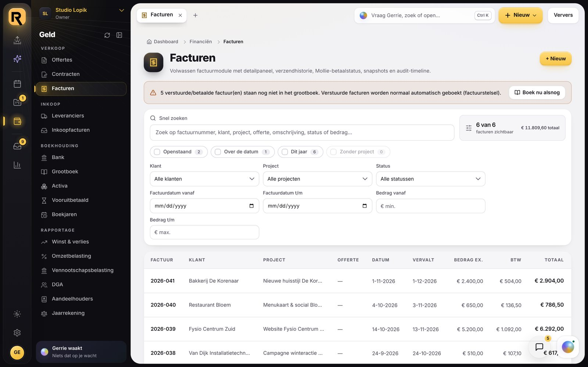
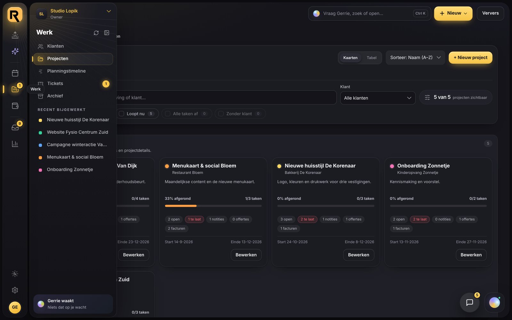
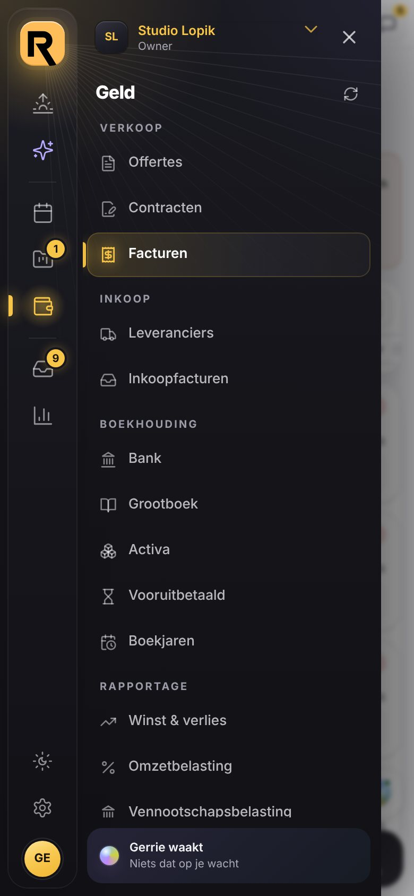

# Baken: het submenu klapt links uit, naast de rail (2026-11-13)

## Wat de PO vroeg

> Pas het design van "baken" zo aan dat het sub menu links uitklapt, zoals bij een andere stijl.
> Dit is de stijl die standaard aan moet staan op de applicatie. Deploy meteen naar staging als je
> klaar bent.

## In het kort

Baken, de standaardlook, heeft nu dezelfde navigatie als Zenit en Stroom. Links staat een smalle
rail met de modules, en direct daarnaast het paneel waarin het submenu van die module uitklapt.
Alles in de kleuren van Baken: rail en paneel vormen samen het donkere commandovlak, ook op Dag.
Waar je bent, gloeit in goud.

| Nacht, het paneel los (schuift uit bij aanwijzen) | De telefoon |
|---|---|
|  |  |

## Wat er was

Baken had de zijbalk van Cockpit. Daarin klapte een submenu als een harmonica open, tussen de
andere regels. Financiën duwde zo tot zeventien regels tussen de rest. Wat eronder stond
(Berichten, Chat, Marketing, Inhoud, Rapportages) verdween dan onder de rand van het scherm.

## Wat er nu is

- **De rail** met zeven modules: Vandaag, Gerrie, Agenda, Werk, Geld, Berichten en Inzicht.
  Een klik opent de module op zijn eerste pagina. Het paneel ernaast toont alles wat je in die
  module kunt, in groepen (bij Geld: Verkoop, Inkoop, Boekhouding, Rapportage). Tellers staan op
  de rail en in het paneel, als gouden pil.
- **Vastgezet of los.** Vastgezet staat het paneel altijd naast de rail en schuift het werkvlak
  op. Los staat alleen de rail, en schuift het paneel uit zodra je de rail aanwijst. Wisselen doe je
  met de knop rechtsboven in het paneel. Wie nooit koos, krijgt vanaf 1280px breed het vaste paneel
  en smaller alleen de rail, net als voorheen bij de zijbalk.
- **Bovenin het paneel** staat de organisatie, in goud. Daar wissel je ook van organisatie of
  administratie. **Onderin** staat Gerrie.
- **Onderin de rail** vind je Weergave, Instellingen en je account. Onder Weergave staan nu ook
  *Met de zon mee* en *Systeem*: in de changelog van Baken stonden die nog als niet gedaan.
- **De rapportages van Gerrie** staan onder Inzicht, net als in de zijbalk onder Rapportages (de
  zes nieuwste, met het lichtje als Gerrie eraan bouwt). Dat geldt nu ook in Zenit en Stroom.
- **De telefoon:** het uitschuifmenu is rail en paneel samen. Een tik op de rail wisselt het
  paneel, een tik in het paneel opent de pagina.
- **Zoeken met Gerrie, + Nieuw en Ververs** blijven rechtsboven in de bovenbalk van Baken.

## De standaard

Baken was al de standaard (sinds 6 november) voor iedereen die zelf niets koos, en dat blijft
zo. Wie zelf Cockpit, Zenit of Stroom koos, houdt die keuze. Baken staat nu bovenaan onder
Weergave → Look. Alleen Cockpit heeft nog de oude zijbalk.

## Om te weten

- Pagina's die in de zijbalk los op het eerste niveau stonden, liggen nu in hun module. Uren zit
  onder Agenda, Klanten en Tickets onder Werk, Inhoud onder Inzicht. Ga je van Vandaag naar Uren,
  dan klik je Agenda (dat opent de agenda) en daarna Uren. Dat is één klik meer dan in de
  zijbalk. Dezelfde indeling had Zenit al.
- De vorm van rail en paneel (maten, plaats, gedrag) deelt Baken met Zenit en Stroom
  (`zenit.css` §4–7). Verander je daar iets, dan verandert het ook in de standaardlook.

## Waar het staat

| bestand | wat |
|---|---|
| `src/lib/look.ts` | `usesRailNav`: Baken, Zenit en Stroom hebben de rail, Cockpit de zijbalk |
| `src/main.tsx` | kiest de navigatie met `usesRailNav` |
| `src/components/ZenitNav.tsx` | in Baken `.cmd-scope` op het hele vlak (donker, ook op Dag); de rapportages van Gerrie onder Inzicht; Baken bovenaan in de lookkeuze; per look de juiste standaard bij Dag en Nacht |
| `src/styles/zenit.css` | §4–7 (rail, paneel, vensters, telefoon) gelden ook voor `data-look="baken"` |
| `src/styles/baken.css` | §3 is nu de rail en het paneel in de kleuren van Baken (was de zijbalk) |
| `src/components/Sidebar.tsx` | alleen nog voor Cockpit: de takken voor Baken zijn eruit |
| `tests/laden/run.mjs` | navigeert via de rail en het paneel |
| `tests/stromen/ui.mjs` | zet Cockpit aan (zie hieronder) |

## Hoe het gecontroleerd is

- `npm run typecheck` en `npm test` (1757 tests): groen.
- `npm run test:loading`: groen. Navigeren loopt nu via de rail en het paneel, van Vandaag via
  Agenda naar Uren. De agenda laadt dezelfde groep (`time`), dus de tellingen gelden nog.
- `npm run test:mobile -- --theme=both`: 620 pagina's op telefoon, tablet, liggend en laptop,
  in Dag en Nacht, in Baken: 0 problemen.
- `npm run build` en `node scripts/check-csp-hash.mjs`: groen.
- Op 1440×900 en 820×1180 (tablet) en 390×844 (telefoon), in Dag en Nacht bekeken: het paneel
  vastgezet en los, Weergave, Inzicht met een rapportage van Gerrie, en het uitschuifmenu op de
  telefoon. Bij Geld past het hele submenu op een scherm van 900px hoog.
- Zenit, Stroom en Cockpit naast de beelden van vóór de wijziging gelegd: niets veranderd.
- Nagemeten: zonder `.cmd-scope` kreeg het donkere paneel op Dag het amber `#855800` en de inkt
  `#5E5E6B` van het lichte werkvlak. Met de klasse is dat `#F7C548` en `#A9A9B6`.
- `npm run test:stromen` is niet gedraaid: die vraagt een lokale Supabase-stack. Hij klikt
  door de zijbalk en zet daarom Cockpit aan. De stromen gaan over offertes, facturen en rechten,
  niet over het menu. Het menu van Baken toetsen `test:loading` en `test:mobile`.
